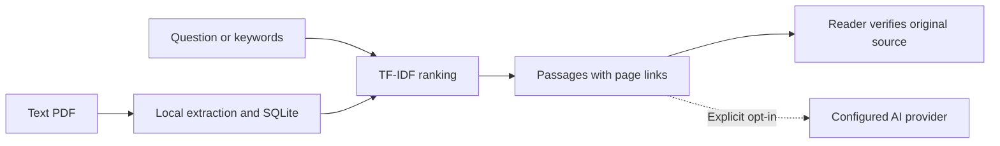

# ResearchDesk AI

**Find the passage. Keep the source.** A local PDF research workspace with page-level evidence and optional AI answers.

[](https://github.com/moamendahshann/researchdesk-ai/actions/workflows/tests.yml)

[Quick start](#quick-start) · [Architecture](#architecture) · [Arabic guide](START-HERE-AR.md) · [Contribution guide](CONTRIBUTING.md)

| Core capability | What it does |
| --- | --- |
| Local document library | Text-based PDFs stored in a local SQLite workspace |
| Evidence-first search | Ranked passages linked to their original PDF pages |
| Arabic and English | Keyword retrieval with Arabic text normalisation |
| Optional AI synthesis | Opt-in generation through a configured compatible provider |

Built for Moamen Dahshan's portfolio with AI-assisted implementation. This is an educational single-user application, not a deployed commercial service.

## What works

* Upload text-based PDFs and retain them in a local SQLite workspace.
* Search across documents or narrow results to one file.
* Inspect ranked passages and open the original PDF at its source page.
* Normalize Arabic text for keyword retrieval alongside English documents.
* Keep the latest 50 questions and export research notes as Markdown.
* Optionally request generated answers from a compatible chat-completions API, with citation-ID checks and graceful fallback to excerpts.
* Delete documents and clear retained question history.

## Quick start

Python 3.11 or 3.12 recommended. From this repository folder:

```bash
python -m venv .venv
```

Windows PowerShell:

```powershell
.venv\Scripts\Activate.ps1
```

macOS / Linux:

```bash
source .venv/bin/activate
```

Then:

```bash
python -m pip install -r requirements.txt
python -m app
```

Open http://127.0.0.1:8000 in your browser. Upload a text-based PDF, then search for words appearing in it. No API key is needed for local search. Stop the server with Ctrl+C.

GitHub hosts the source code. GitHub Pages cannot run this Python backend.

## Demo and tests

```bash
python -m pip install -r requirements-dev.txt
python samples/make_demo.py
python -m pytest -q
python -m tests.evaluate
```

Upload `samples/demo.pdf`, then try `bicycle repair`, `solar panels`, or `food collection`. Demo content is fictional. The evaluation uses a tiny synthetic corpus and is a regression check, not a real-world quality benchmark.

## Optional generation

Set these environment variables before starting the application:

```powershell
$env:LLM_API_KEY="your-key"
$env:LLM_BASE_URL="https://your-provider.example/v1"
$env:LLM_MODEL="your-model-id"
python -m app
```

On macOS/Linux use `export NAME="value"` instead. The server appends `/chat/completions` to the base URL. The provider must accept a compatible messages payload. No `.env` file is loaded automatically. Never commit keys.

Generation is off by default. When enabled per query, the question and retrieved passages go to your configured provider; their retention rules and charges apply. The key stays on the server. Integration tests mock the provider; a live paid model was not tested.

## Architecture

Browser → FastAPI → PDF extraction / SQLite → TF-IDF ranking → source passages → optional remote generation.



* `app/core.py`: PDF extraction, overlapping chunks, Arabic normalization, TF-IDF cosine ranking.
* `app/main.py`: HTTP API, persistence, browser origin checks, optional model integration.
* `app/static/`: responsive interface, document management, history, Markdown export.
* `tests/`: API lifecycle, validation, retrieval, provider fallback and browser isolation tests.
* `docs/`: design decisions, limitations and extension plan.

## Scope and limitations

This version uses lexical retrieval, not embeddings or cross-language semantic search. Scores measure text similarity, not answer confidence. Citation validation checks referenced IDs only, not whether every sentence is supported. Always review the passages.

Image-only PDFs require OCR elsewhere. Extraction quality depends on the PDF, especially tables and complex layouts. Upload limits are 10 MB, 200 pages and 20 documents. Parsing and index construction run in the local process; large complex PDFs can be slow.

The app has no accounts, role management or multi-user isolation. Run it locally with documents you trust; do not expose it directly to the public internet. Documents and history are stored unencrypted in `data/workspace.sqlite3`. Deleting a document clears all history, but is not forensic secure erasure of SQLite files or backups.

## Development roadmap

Planned, not implemented: cached embedding retrieval, an annotated real-document evaluation set, background ingestion, OCR, authentication and per-user document permissions. See [design notes](docs/DESIGN.md).

## References

* [FastAPI documentation](https://fastapi.tiangolo.com/)
* [pypdf extraction limitations](https://pypdf.readthedocs.io/en/stable/user/extract-text.html)
* [scikit-learn text feature extraction](https://scikit-learn.org/stable/modules/feature_extraction.html#text-feature-extraction)

No open-source license has been selected yet. Choose an appropriate license before inviting external reuse.
